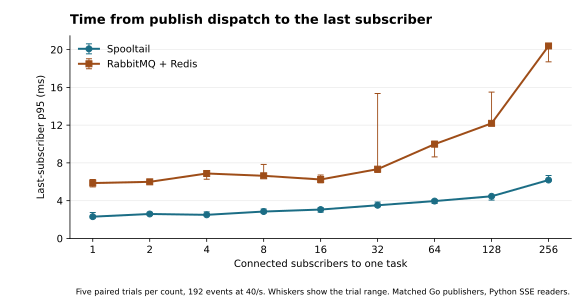

# Live fan-out to subscribers watching one task

Spooltail had a lower last-subscriber p95 at **all nine tested counts from 1 through 256** in two workloads. At 40 updates/s with matched Go publishers, it won 45 of 45 paired trials. At 160 updates/s with the original Python HTTPX and Relayna publishers, it won 44 of 45. All 511 matched subscriber IDs had a lower median p95 in each sweep. With the original Python publishers at 40 updates/s, RabbitMQ + Redis retained a small-count advantage.



## Matched publishers

Each stack received 192 events per trial at 40/s. Both producers serialized each event in Go, reused a connection and waited for a durable receipt before issuing another publish. Spooltail used its HTTP POST endpoint. RabbitMQ used the official AMQP 0-9-1 Go library. Both served their public SSE endpoints to the same Python readers. The timer starts in the controller before the handoff to either producer, including scheduling, serialization, networking and delivery. Every subscriber checked payload, ID, ordering and terminal closure.

Times are milliseconds. For each event, the driver takes the slowest subscriber's receipt time, computes p95 over the events in that trial, then reports the median across five trials. The matched-reader column compares each reader ID's median trial p95 between stacks. The final column counts paired trials in which Spooltail reached the last reader sooner at p95.

| Subscribers | Spooltail last-reader p95 | RabbitMQ + Redis last-reader p95 | Reduction | Matched readers faster | Paired trial wins |
| ---: | ---: | ---: | ---: | ---: | ---: |
| 1 | 2.30 | 5.87 | 61% | 1/1 | 5/5 |
| 2 | 2.59 | 5.99 | 57% | 2/2 | 5/5 |
| 4 | 2.50 | 6.88 | 64% | 4/4 | 5/5 |
| 8 | 2.85 | 6.63 | 57% | 8/8 | 5/5 |
| 16 | 3.06 | 6.24 | 51% | 16/16 | 5/5 |
| 32 | 3.51 | 7.34 | 52% | 32/32 | 5/5 |
| 64 | 3.96 | 9.98 | 60% | 64/64 | 5/5 |
| 128 | 4.46 | 12.19 | 63% | 128/128 | 5/5 |
| 256 | 6.18 | 20.39 | 70% | 256/256 | 5/5 |

The two stacks verified **981,120 deliveries** in this sweep. Spooltail won **45/45** last-reader comparisons and **511/511** matched reader-ID comparisons. Median trial last-reader p99 was also lower at all nine counts, from 6.14 vs 6.72 ms at one reader to 9.81 vs 25.38 ms at 256. Each 192-update trial has only two observations at or beyond its nearest-rank p99. At 256 readers, publish-confirmation p95 was 2.64 ms on Spooltail and 0.94 ms on RabbitMQ. RabbitMQ confirms before the hub delivers through Redis. The publisher and network both contribute to end-to-end latency. [Matched raw results](runs/matched-go.json) · [Producer implementation](publisher/main.go) · [Aggregation script](summarize.py)

## Why the broker changed

On the head of #14, 256 connected subscribers triggered 12,288 journal payload reads for 48 events. The index found the right frames, but every subscriber independently requested a page, waited for the store lock, read the frame and decoded the same JSON. Sharing each committed event removed all 12,288 steady-state reads. Broker CPU fell from 1.376 to 0.239 CPU-seconds per 48-event trial in the shared-delivery-only experiment. Median last-reader p95 fell from 27.77 to 9.72 ms. [Parent runs](runs/parent-python.json) · [Shared-delivery-only runs](runs/shared-only-python.json)

The broker now registers the subscriber and resolves its cursor under the same lock. A task with live subscribers holds an eight-event broadcast window. The broker serializes the event once and shares a reference after commit. A reader that misses the window resumes from indexed history and discards any overlap. Advancing retention can still produce a gap, and a terminal event closes the subscription. With 1 MiB maximum frames, the window retains up to roughly 8 MiB of payload per watched task, plus reader and transport buffers. The window is released when the last subscriber disconnects. [Broker implementation](../../src/live.rs) · [Tokio broadcast behavior](https://docs.rs/tokio/latest/tokio/sync/broadcast/index.html)

With one reader, eliminating duplicate work buys little. The default single-partition publish used to sync both the journal frame and its SQLite address. The journal already contains the information needed to reconstruct a lost suffix of addresses in physical order. Ordinary appends now sync the journal and write those addresses through a WAL connection using `synchronous=NORMAL`. The coordinator still uses `FULL` for consumer checkpoints, leases, completion receipts and partition registration. Adding a second partition establishes a durable boundary before offsets can interleave across journals. [Storage design](../../docs/design.md) · [SQLite synchronous modes](https://www.sqlite.org/pragma.html#pragma_synchronous)

A separate 160-update HTTPX trace measured 3.76 ms p95 from application dispatch to the first socket send, 2.67 ms p95 inside the journal sync and 0.97 ms p95 from sync completion to receipt. The end-to-end p95 was 8.68 ms. These are independent percentiles. This diagnostic shared one asyncio loop between producer and reader. The comparative runs use separate reader processes. [Monotonic timestamp samples](runs/httpx-trace.json)

Running the same Go producers and SSE readers against the unmodified #14 head isolates the broker change. Last-reader p95 on #14 was 3.14, 4.44, 7.77 and 23.63 ms at 1, 16, 64 and 256 readers. At 256, **zero of 256** matched readers beat RabbitMQ + Redis on #14. With the fix **all 256** did. For 192 updates at this count, broker CPU fell from 5.39 to 0.83 CPU-seconds and journal payload reads fell from 49,152 to zero. Both versions used 192 events per trial. The parent ran three paired trials and the fix ran five. [Parent with matched Go producers](runs/parent-go.json) · [Fix with matched Go producers](runs/matched-go.json)

## Python SDKs

Using Spooltail’s existing Python `SpooltailClient.publish` and `SpooltailClient.subscribe` together over plaintext gRPC, the median last-reader p95 was lower at all four original subscriber counts. Both SDKs delivered decoded dictionaries. The control published through the Relayna AMQP client and received SSE from the SDK API. Three paired trials used 128 updates at 40/s. The small-count lead was narrow and varied by trial.

| Subscribers | Spooltail Python SDK last-reader p95 (ms) | Relayna RabbitMQ + Redis last-reader p95 (ms) | Matched readers faster | Paired trial wins |
| ---: | ---: | ---: | ---: | ---: |
| 1 | 7.85 | 8.57 | 1/1 | 2/3 |
| 16 | 8.88 | 9.11 | 8/16 | 2/3 |
| 64 | 8.37 | 9.66 | 18/64 | 3/3 |
| 256 | 8.64 | 20.32 | 245/256 | 3/3 |

A separate command-line smoke test with 24 updates illustrates the small-count variation. At 16 readers its last-reader p95 was 8.44 vs 6.90 ms. It also verified a 64-reader reconnect through the two public SDKs. [Smoke results](runs/python-sdk-smoke.json)

Reuse a `SpooltailClient` channel per event loop. One producer issued one durable publish at a time, and up to four reader processes each shared one channel across their gRPC subscriptions. Browser subscribers can use the SSE endpoint measured above. [Python SDK](../../python/README.md) · [Python SDK raw results](runs/python-sdk.json)

## Original Python HTTP/SSE workload

Three paired trials per case, 48 small updates per live trial, same Python HTTPX publisher and SSE subscribers used in the original benchmark. Each version had its own paired RabbitMQ + Redis run. Times are the median trial p95 from dispatch to the **last** subscriber, in milliseconds.

| Subscribers | #14 | RabbitMQ + Redis alongside #14 | With this fix | RabbitMQ + Redis alongside fix |
| ---: | ---: | ---: | ---: | ---: |
| 1 | 9.11 | 7.03 | 7.29 | 7.10 |
| 16 | 6.85 | 8.12 | 8.98 | 8.18 |
| 64 | 9.01 | 10.48 | 8.52 | 9.05 |
| 256 | 27.77 | 19.49 | 9.65 | 19.56 |

This original client combination still lost at 1 and 16. It beat the control at 64 and 256. The 16-reader result also regressed against #14. A separate three-trial screen of unary gRPC publishing, bidirectional gRPC publishing, WebSocket publishing, and an alternate HTTP server scheduling/encoding path did not yield a consistent win across these four tiers. Reusing an HTTP connection on a Python worker thread and substituting an aiohttp producer also lost at 64. Moving the original Python publishers into their own processes with the same measured IPC handoff as the Go publishers yielded 8.41 vs 8.12 ms at one reader and 9.69 vs 8.91 ms at 64. The matched Go lead therefore depends on more than the handoff alone. The PR keeps the public broker protocols intact. [Prototype timing samples](runs/prototype-screen.json) · [Parent runs](runs/parent-python.json) · [Fixed runs](runs/fixed-python.json)

A longer check with the same HTTPX producer used five paired trials per count and 192 updates at 40/s. Spooltail lost at 1, 16 and 64 readers in all five rounds at each count. It won at 256 readers in all five rounds. At 64, the longer sample reverses the small lead in the 48-update fixture. The original HTTPX comparison therefore supports a clear claim at 256. [Longer HTTPX runs](runs/steady-python-40.json)

| Subscribers | HTTPX → Spooltail last-reader p95 (ms) | Relayna → RabbitMQ + Redis last-reader p95 (ms) |
| ---: | ---: | ---: |
| 1 | 8.39 | 7.36 |
| 16 | 9.41 | 8.49 |
| 64 | 9.79 | 9.06 |
| 256 | 8.51 | 19.52 |

## Original Python clients at 160 updates/s

The same HTTPX publisher, Relayna AMQP publisher, and SSE readers handled 192 events per trial. The driver changed the target rate to 160/s. All 90 runs achieved 159.52–159.99 publishes/s. Both stacks delivered every expected update. The 256-reader RabbitMQ + Redis result includes a backlog in the tested one-worker SSE stack. In a separate 256-update screen at that count, its API used 2.74 CPU-seconds while the producer dispatched the events in about 1.6 seconds.

| Subscribers | Spooltail last-reader p95 (ms) | RabbitMQ + Redis last-reader p95 (ms) | Reduction | Matched readers faster | Paired trial wins |
| ---: | ---: | ---: | ---: | ---: | ---: |
| 1 | 2.40 | 3.43 | 30% | 1/1 | 5/5 |
| 2 | 2.81 | 3.37 | 17% | 2/2 | 4/5 |
| 4 | 2.77 | 3.40 | 19% | 4/4 | 5/5 |
| 8 | 2.92 | 3.70 | 21% | 8/8 | 5/5 |
| 16 | 3.25 | 4.00 | 19% | 16/16 | 5/5 |
| 32 | 3.35 | 4.73 | 29% | 32/32 | 5/5 |
| 64 | 3.39 | 6.84 | 50% | 64/64 | 5/5 |
| 128 | 4.26 | 32.19 | 87% | 128/128 | 5/5 |
| 256 | 6.04 | 1205.37 | 99% | 256/256 | 5/5 |

Spooltail won the median last-reader p95 in every tier and 44 of 45 individual paired trials. The exception was one two-reader trial. Individual long-tail events still varied. Median trial last-reader p99 favored the control at 2, 4 and 16 readers, with gaps of 0.11, 0.10 and 0.51 ms, respectively. The 1,205 ms result at 256 applies to this status hub and single API worker. [Five-round raw results](runs/steady-python-160.json) · [Three-round screening results](runs/python-160-screen.json)

To locate the rate effect, a single-reader HTTPX probe alternated 40, 160, 160 and 40 updates/s, with 160 measured updates in each fresh broker run. Client and server hooks timestamped the first socket send, broker receipt of the HTTP header and the journal sync using the same Linux monotonic clock. At 40/s versus 160/s, the median of the two trial p95s was 3.88 vs 0.71 ms before the first socket send, 2.70 vs 0.94 ms inside journal sync and 0.94 vs 0.49 ms from sync completion to SSE receipt. The dispatch-to-receipt p95 moved from 8.71 to 2.54 ms. Both the client and storage timings changed with pacing. The probe shared one event loop for the producer and reader, so its absolute times are separate from the paired benchmark. [Alternating-rate timestamp samples](runs/httpx-rate-trace.json)

## Large payloads, slow readers and reconnects

The two 32-reader scenarios each published 96 events carrying 32 KiB at 50/s. With all readers consuming promptly, last-reader p95 was **7.99 vs 17.86 ms**. With four readers deliberately sleeping 50 ms between records, the 28 fast readers saw **5.71 vs 13.94 ms** pooled p95. The last reader took **3.162 vs 3.153 seconds**. Both stacks delivered every event, including to the delayed readers.

After 256 simultaneous reconnects with publishing in progress, p95 time to receive the 24th missed event was **76.99 vs 442.05 ms**. Last-reader p95 for new live updates during that burst was **80.52 vs 565.36 ms**. Reconnecting readers need durable history and incur journal reads. Spooltail had zero journal payload reads in every fully caught-up live trial. [Original workload and reconnect results](runs/fixed-python.json)

## Correctness and operating conditions

Each reader verifies the full event, its identity, its order and terminal stream closure. The benchmark alternates which stack runs first. Each stack serves a single task in its own containers on one 10-CPU Linux ARM64 Docker Desktop VM. Up to four Python processes host the subscribers. The producer allows one outstanding publish, uses a persistent connection and waits for each acknowledgement. Payloads are 256 bytes of application data in the small-event case. The driver uses a single monotonic clock. The results cover warm services, plaintext local networking, one publisher and the rates specified for each experiment.

The control uses RabbitMQ 4.3.6 with a durable status stream and confirmed persistent AMQP publishes, the released Relayna v1.14.0 status hub, Redis 7.4.12 with AOF and `appendfsync always`, and the SDK's SSE route in one Uvicorn worker. A RabbitMQ confirmation can precede hub ingestion and Redis distribution. Publish-ack latency and last-subscriber latency answer different questions. [Control configuration](../compose.yaml) · [RabbitMQ publisher confirms](https://www.rabbitmq.com/docs/confirms)

Two forced hypervisor stops tested the single-journal storage change. After each cut, a fresh Linux VM mounted the persistent ext4 volume and read back 96 acknowledged events, all offsets, the saved audit cursor and the settled work receipt. Idempotent retries returned the original offsets. Recovery rebuilt 96 frame addresses after the single-journal cut. The run that added a second partition rebuilt zero. The Rust suite also restores a deliberately missing index suffix across journal rollover. The power tests model abrupt guest and OS cache loss on this host. Physical storage power loss, replicated brokers and production network latency need separate measurements. [Power-cut runner](power_cut.py) · [Regression tests](../../src/tests.rs)

On disposable APFS images, both shared and partitioned indexes passed disk-full foreground append/retry, packing retry and reserve-admission tests. The retirement suite also passed, including completion receipts across a partition move. [Disk-full tests](../../tests/packed_journal_disk_full.py) · [Retirement tests](../../tests/packed_journal_retirement.py)

## Reproduce

Use Docker Compose, Python 3.11 or newer and a checkout of the Relayna SDK at tag `v1.14.0`. The optional matched Go benchmark uses a local Go installation to cross-compile its two producers for the Docker server. The broker and consumers have no Go dependency.

```sh
python3 benchmarks/event-stream/run_fanout.py --sdk /path/to/relayna \
  --trials 3 --output /tmp/spooltail-python.json

python3 benchmarks/event-stream/run_fanout.py --sdk /path/to/relayna \
  --publisher go --trials 5 --live-events 192 \
  --cases live-1 live-2 live-4 live-8 live-16 live-32 live-64 live-128 live-256 \
  --output /tmp/spooltail-go.json

python3 benchmarks/event-stream/run_fanout.py --sdk /path/to/relayna \
  --trials 5 --live-rate 160 --live-events 192 \
  --cases live-1 live-2 live-4 live-8 live-16 live-32 live-64 live-128 live-256 \
  --output /tmp/spooltail-python-160.json

python3 benchmarks/event-stream/run_fanout.py --sdk /path/to/relayna \
  --python-sdk --trials 3 --live-events 128 --cases live-1 live-16 live-64 live-256 \
  --output /tmp/spooltail-sdk.json

python3 benchmarks/event-stream/summarize.py /tmp/spooltail-python.json /tmp/spooltail-go.json /tmp/spooltail-sdk.json
```

Each output path must be new. The runner creates an isolated Compose project and removes its containers and volumes on exit. For the parent comparison, copy the event-stream harness into a checkout of `aa495d1` and run the same command there. To repeat the power cuts on Apple Silicon with Lima, pass a Linux ARM64 release binary to `python3 benchmarks/event-stream/power_cut.py --broker /path/to/spooltail`. It creates disposable VMs and a dedicated volume. [Historical indexed-history experiment](indexed-history.md)
