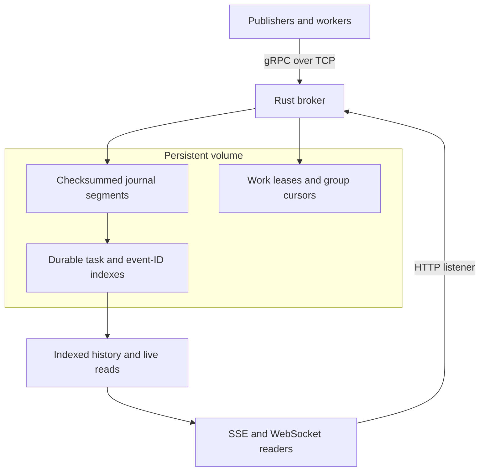

# Spooltail architecture draft

**Status** · Initial proposal and single-node reference prototype. The original deployment observed over 800,000 retained RabbitMQ statuses, 100% CPU on a service restart using `first`, and normal CPU after switching to `next`. The current SDK hub lacks a durable source checkpoint. These observations establish that the two configurations requested different amounts of replay. They do not attribute CPU to decoding, Redis, the broker, or the number of hub instances.

## Deployment and storage

Spooltail owns the work queue, retained events, task lookup and live subscriptions. The intended AKS deployment uses broker pods with persistent volumes and stateless SDK/API clients. Each task routes to one shard within its namespace. A topic names a stream of related records, such as `inference.tasks` or `inference.status`. The prototype has one namespace and starts with partition 0. Numeric offsets follow SQLite commit order across every topic and partition, so successive offsets for a task, topic, or partition can be sparse. Event timestamps are producer data.

Service clients connect to the configured gRPC listener over TCP. TLS is the default, with an explicit plaintext mode. The browser HTTP/SSE listener and gRPC listener share one broker process, including the store, lease and checkpoint state, and post-commit notifications. The versioned Protobuf contract carries the original JSON event in a bytes field.

The segment layout puts one copy of an event on disk. A lookup from `(topic, task_id, event_id)` yields a logical offset. An ordered index on `(topic, task_id, offset)` finds the next matching records. Each index entry names a segment, byte position and frame length. A separate topic/offset index serves service-wide readers. The shared SQLite index runs in process with WAL and full synchronous commits. Its pages and the filesystem cache accelerate hot reads. An alternative first design stored all event values in an embedded ordered key-value engine. Native segments make the sparse task read, checkpoint and crash boundary directly observable at the cost of maintaining a file format.

Each frame consists of a little-endian 32-bit body length, a little-endian CRC32, and UTF-8 JSON containing `topic` and `event`. The prototype rolls files at 8 MiB and caps a frame body at 1 MiB. These are experimental defaults. Segment addresses are private. Clients hold logical event IDs for task subscriptions.

## Commit, crash and restart

One broker owns the volume. Each partition serializes appends to its own journal and can flush concurrently with other partitions. The shared index serializes SQLite commits. A successful response means the framed payload was flushed and all its index entries committed. The final committed index row also identifies the end of the indexed prefix. If an append meets an uncertain disk failure, further appends require restart. Startup seeks directly to that position, validates suffix frames, indexes them and discards an incomplete final frame. A checksum mismatch on a complete frame stops recovery for inspection. Starting the API does not entail replaying the journal. A missing or damaged volume is a different failure domain.

Suppose `E42` reaches disk, then AKS kills the pod before the index commit or publisher response. Recovery opens the existing index at `E41`, validates the complete `E42` frame and commits its address. The producer retries the same prepared payload and ID and receives the original offset. If the index commit already succeeded, recovery begins after `E42`. Recovery and producer deduplication finish before a new append can pass the missing record.

A worker can complete a claim with one terminal event. Under the single-writer lock, the broker checks the source task, group, lease generation, and deadline. The journal frame contains the public status event and a private `completion` field with the source topic, group, work offset, and generation. One SQLite transaction indexes the event and marks that lease done. Live readers wake after commit. An uncertain write blocks further appends and lease changes until recovery.

A complete suffix frame replays both effects even if the accepted lease has since expired. A torn frame leaves the previous lease state intact. On an exact retry the broker looks up the terminal event and checks its payload and recorded lease identity before returning the original status offset. A plain publish has no completion receipt. Existing volumes open directly in the new broker. Once a volume contains completion frames, use a completion-aware broker for recovery.

Group cursors and leases are authoritative SQLite rows on the same volume. A full backup therefore needs a consistent copy of the index database, its SQLite recovery files, and the journal. Rebuilding only the event index from segments cannot reconstruct worker settlements or consumer progress. A production design must cover coordinated snapshots, backups and versioned on-disk migrations.

## Topics, subscriptions and replay

- A **work subscription** owns leases for one topic and group. Replicas share work. The broker durably assigns a generation per claim. Expired leases can be claimed again, and stale workers cannot renew or settle them. Retry releases the active generation. Dead-letter settlement removes the record from that group’s ready work. External handler effects need an idempotency key.
- A **stream subscription** owns a processed prefix per topic and group. Consumers apply a record before committing its offset. Lost responses or crashes can repeat delivery. Two independent groups can read the same record at different speeds. Groups can use one broker-wide checkpoint or one checkpoint per partition. The application assigns one logical reader per checkpoint. Simultaneous readers of the same checkpoint can receive duplicates. Automated group assignment and owner fencing remain production work.
- A **task subscription** reads indexed pages for one task. A fresh reader replays retained history. A resuming reader starts strictly after its event ID. Registering for wakeups before reading, and querying the durable index again on wake, closes the replay/live race. Bounded pages limit per-reader buffering. SSE, WebSocket, and gRPC streams use this reader. A slow reader resumes from its own cursor. A socket write does not establish durable application processing.
- A **retention gap** requires a decision. Task streams expose the earliest available event ID. A group whose next unprocessed record has expired gets a conflict. State-only consumers can use a future snapshot with a watermark. Readers that owe every transition require archived events or explicit loss acceptance. Source retention, deduplication lifetime and task expiry are distinct policies.

## Partition expansion and task moves

The partition registry and task placements live in the shared SQLite index. An existing task without a placement row belongs to partition 0. Adding a partition changes assignment only for first publishes. Each record holds its immutable journal partition and its current work partition. Task moves wait for in-flight appends on that task and update the work partition and task placement in one transaction. The shared lease table still addresses the original record, so an active worker can complete through the move and preserve the original completion receipt. The destination journal contains future events. Pending work changes placement through the index without a second public append.

Service rules define eligible partitions and keep them out of the general pool. The first publish records ownership and placement. Later publishers use the saved owner. Dynamic placement is opt-in. It selects the least-loaded eligible journal for new tasks and checks that pool for a better destination when a publish finds the current journal congested. The move transaction increments a durable routing epoch. Publishers compare it after taking the journal lock, and the coordinator prevents moves once an append is marked in flight.

Task history follows the task index in broker offset order across journals. For partition-scoped stream readers, the first record after a move waits for the group's checkpoint on the preceding record's partition. This preserves per-task delivery order while allowing independent groups to progress separately.

## SQLite indexes per partition

The shared index remains the default for new volumes. The partitioned mode assigns global offsets before writes, records those offsets in the journal frames, and commits record addresses in separate partition databases. Partition databases use WAL with `synchronous=NORMAL`. The partition journal is the durable source for the offset, payload, and completion receipt. Because the journal sync finishes before the SQLite transaction starts, replay can restore any index transactions lost after a power failure. The coordinator keeps full synchronous commits for leases, cursors, and the applied-completion marker. A broker-wide in-memory SQLite projection publishes only in offset order. Readers can therefore use the existing global cursor and per-task history semantics even when physical commits finish out of order. A complete durable frame can be recovered after a lost response. Reservations with an incomplete frame leave a gap if a later offset survives.

Inline SQLite indexing is the default. With background batching, queued writers can share a sync for up to 16 frames in one journal segment. The writer syncs pending frames before rotating segments. After sync, durable writes can wait for global visibility while the next group writes. Index metadata enters the background queue only after journal sync and in FIFO journal order. Each index transaction extends the partition's index checkpoint as a contiguous prefix. The live projection and completion receipts can advance before that checkpoint. Recovery uses the journal to restore any missing rows and applies completion receipts idempotently.

The coordinator SQLite file remains authoritative for routes, leases, and checkpoints. For completion, the destination partition durably records the lease identity with the event. Then one coordinator transaction settles the lease and records that the completion was applied. The broker holds the metadata lock through publication. On restart it reconstructs the replay projection and applies any missing settlements before serving requests. The durable applied marker and lease settlement share one transaction. Recovery does not rely on atomic WAL commits across separate database files.

Enabling the mode first recovers legacy journal tails with the original allocator. The pre-upgrade index becomes the immutable source for old record addresses. Every restart rebuilds the projection from that index and the partition indexes. Task moves still update routing and work ownership together under the coordinator lock. An uncertain publication closes the partitioned request path until the broker can recover.

## Relayna integration boundary

Relayna’s existing Python SDK defines transport envelopes, aliases, routing, status sanitization, bounded recent history, full stream history, terminal statuses and SSE response shapes. Spooltail accepts explicit opaque JSON events with stable IDs and preserves extra fields. The first backend adapter must preserve the SDK’s deterministic ID generation, configured field aliases, metadata filtering, priorities, batching, retry headers, DLQ visibility and latest/history/SSE semantics. In particular, existing SSE falls back to retained history when an ID is unknown. The new native protocol reports a gap. Existing clients need an explicit compatibility policy.

Review the released SDK sources for [publisher behavior](https://github.com/sarattha/relayna/blob/v1.14.0/src/relayna/rabbitmq/client.py), [task and retry settlement](https://github.com/sarattha/relayna/blob/v1.14.0/src/relayna/consumer/task_consumer.py), [status ingestion](https://github.com/sarattha/relayna/blob/v1.14.0/src/relayna/status/hub.py), [historical replay](https://github.com/sarattha/relayna/blob/v1.14.0/src/relayna/status/history.py), and [SSE resume](https://github.com/sarattha/relayna/blob/v1.14.0/src/relayna/status/stream.py).

Retiring Redis across Relayna also covers workflow contract state, child-task lookups, DLQ indexes, observation stores and service feeds. The prototype exercises event delivery, work delivery, and atomic task completion. Production features still to design include public SDK compatibility, replicated commit and failover, authenticated namespaces, durable snapshots, physical retention and compaction, group rebalancing, and load-tested backpressure. Kafka wire compatibility is a separate product decision.
